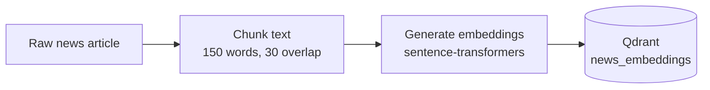
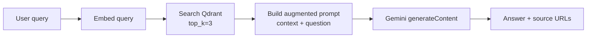
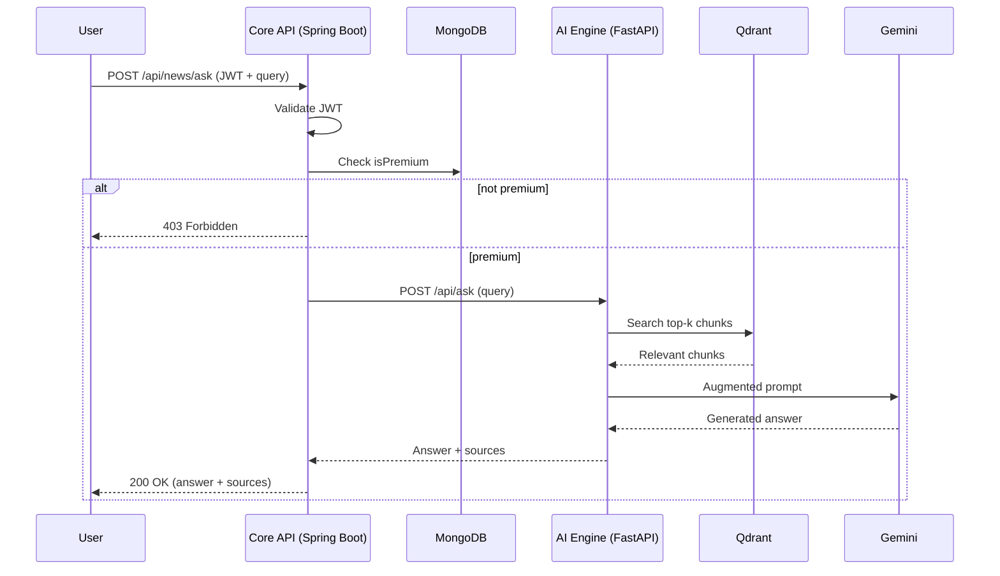

# AI-Powered Conversational News Assistant

A microservices-based, AI-driven news assistant using a Retrieval-Augmented Generation (RAG) pipeline. Users ask natural-language questions about ingested news articles and get grounded, source-cited answers — powered by Gemini and semantic search over a vector database.

## Architecture

| Service      | Tech                        | Port  | Responsibility |
|--------------|------------------------------|-------|----------------|
| `ai-engine`  | Python 3.11 / FastAPI        | 8000  | Embeddings, vector search, Gemini RAG pipeline |
| `core-api`   | Java 17 / Spring Boot 3.x    | 8080  | User auth (JWT), premium gating, payment orders, routes AI queries |
| `mongodb`    | MongoDB 7                    | 27017 | User accounts, subscription status |
| `qdrant`     | Qdrant v1.11                 | 6333 / 6334 | Vector store for news embeddings |

```
User → Spring Boot (JWT auth, premium check) → FastAPI (RAG: embed → search Qdrant → Gemini) → Answer + sources
```

## Pipeline

### 1. Ingestion Pipeline (Service A)



`POST /api/ingest` accepts a batch of articles. Each article's content is split into overlapping word chunks (so context isn't lost at chunk boundaries), each chunk is embedded into a 384-dimensional vector using `all-MiniLM-L6-v2`, and the vectors are upserted into Qdrant along with their title, source URL, and published date as payload.

### 2. RAG Query Pipeline (Service A → Gemini)



`POST /api/ask` embeds the incoming query with the same model used at ingestion, retrieves the top-k most semantically similar chunks from Qdrant, and injects them into a prompt that instructs Gemini to answer **only** from that context (preventing hallucinated answers outside the ingested news). The response includes the generated answer plus the deduplicated source URLs it was grounded in.

### 3. End-to-End Request Flow (Service B → Service A)



A request to `/api/news/ask` first passes through Spring Security's JWT filter, then `NewsService` checks the authenticated user's `isPremium` flag in MongoDB. Only premium users are forwarded to Service A's RAG pipeline; everyone else gets a `403`.

## Tech Stack

- **Python FastAPI** — async API engine for AI operations
- **Qdrant** — vector database for semantic search over news content
- **Google Gemini API** — LLM for grounded answer generation
- **Java Spring Boot** — auth, authorization, and security layer
- **Razorpay API** — subscription/payment gateway integration
- **MongoDB** — user profiles and subscription status
- **Docker Compose** — orchestrates all four services

## Features

- 🔍 Semantic search over ingested news articles (chunked + embedded with `sentence-transformers`)
- 🤖 RAG pipeline: retrieves top-k relevant chunks, grounds Gemini's answer in that context, returns source URLs
- 🔐 JWT-based authentication with BCrypt-hashed passwords
- 💳 Premium-gated AI queries with a Razorpay order-creation stub
- 🐳 Fully containerized — one command to run the whole stack

## Prerequisites

- Docker & Docker Compose v2
- A [Google Gemini API key](https://aistudio.google.com/apikey)
- (Optional) Razorpay test key id/secret

## Setup

```bash
git clone https://github.com/thesupremesorcerror/ai-news-assistant.git
cd ai-news-assistant
cp .env.example .env
# edit .env: GEMINI_API_KEY, JWT_SECRET, RAZORPAY_KEY_ID/SECRET
docker compose up --build
```

First build takes a few minutes — the AI engine downloads the embedding model and Maven resolves Spring Boot dependencies.

## Usage

```bash
# 1. Register a user
curl -X POST http://localhost:8080/api/auth/register \
  -H "Content-Type: application/json" \
  -d '{"email":"[email protected]","password":"password123"}'

# 2. Ingest a news article
curl -X POST http://localhost:8000/api/ingest \
  -H "Content-Type: application/json" \
  -d '{"articles":[{"title":"RBI Holds Rates","content":"The Reserve Bank of India kept the repo rate unchanged at 6.5%.","source_url":"https://example.com/rbi","published_date":"2026-09-01"}]}'

# 3. Ask a question (requires isPremium=true on the user)
curl -X POST http://localhost:8080/api/news/ask \
  -H "Authorization: Bearer <JWT_FROM_LOGIN>" \
  -H "Content-Type: application/json" \
  -d '{"query":"What did the RBI decide?"}'
```

To mark a user premium for local testing (until the Razorpay webhook flow is wired up):

```bash
docker exec -it news-assistant-mongodb mongosh news_assistant --eval "db.users.updateOne({email:'[email protected]'},{\$set:{isPremium:true}})"
```

## API Endpoints

| Method | Endpoint | Auth | Description |
|--------|----------|------|-------------|
| POST | `/api/auth/register` | No | Create a new user account |
| POST | `/api/auth/login` | No | Get a JWT token |
| POST | `/api/news/ask` | JWT + Premium | Ask a question, answered via RAG |
| POST | `/api/payment/create-order` | JWT | Create a Razorpay order |
| POST | `/api/ingest` | No (internal) | Ingest news articles into the vector store |
| POST | `/api/ask` | No (internal) | Direct RAG query to the AI Engine |

## Notes

- Mongo and Qdrant run without auth — this is a local dev/portfolio setup, not production-hardened.
- Payment flow creates Razorpay orders but does not yet verify payment callbacks/webhooks to auto-upgrade `isPremium`.
- Gemini model names deprecate periodically — if you hit a 404, check the error message (Google's API returns the current recommended model) and update `GEMINI_MODEL_NAME` in `service-a-ai-engine/app/services/gemini_service.py`.
